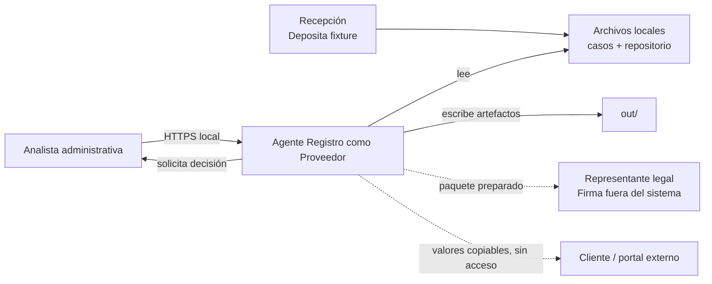
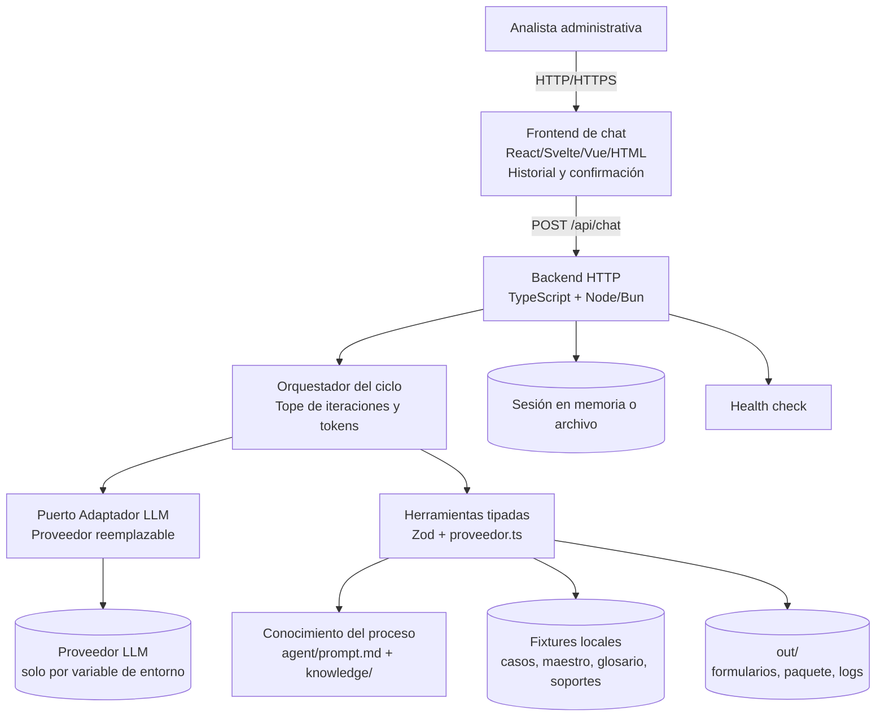
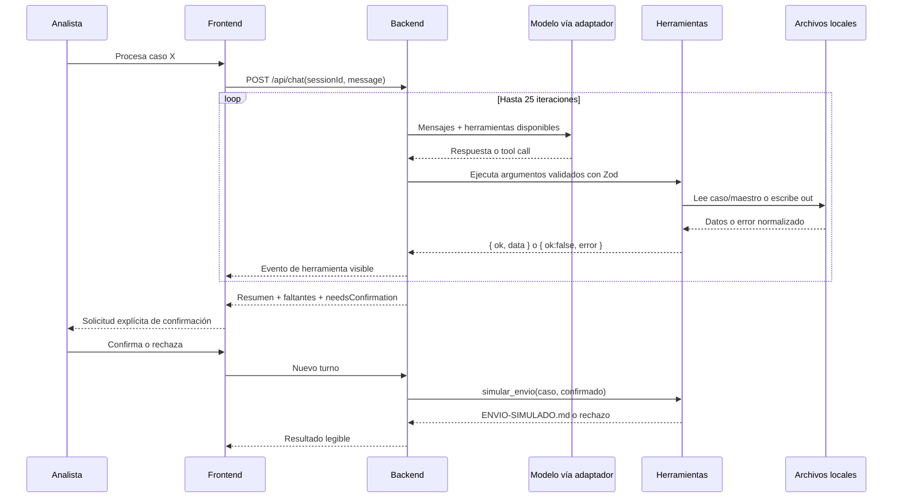

# Solución arquitectónica

## 1. Resumen ejecutivo

El sistema automatiza la preparación de registros como proveedor para la analista administrativa: lee solicitudes y plantillas locales, cruza los campos contra un repositorio maestro, genera el formato solicitado, arma un paquete para firma y deja la decisión de envío a una persona.

Se adopta un **monolito modular TypeScript** con frontend de chat y backend HTTP. El backend contiene el ciclo del agente, un adaptador LLM reemplazable y herramientas tipadas con Zod. Los fixtures son de solo lectura; `out/` contiene los artefactos y auditoría de cada caso. No se integran correo real, SharePoint, firma electrónica ni portales.

Decisiones clave:

- La única fuente de valores afirmables son las herramientas que leen el repositorio local.
- La confirmación humana es un control obligatorio y específico por caso antes de `ENVIO-SIMULADO.md`.
- El flujo se mantiene local y modular porque el PRD no exige persistencia, autenticación ni escalabilidad distribuida.

## 2. Alcance y fuera de alcance

### Dentro del alcance

- Chat con historial, estado de pensamiento, llamadas de herramientas visibles y solicitud de confirmación.
- Lectura de `casos/<caso>/`, maestro, glosario y catálogo de soportes.
- Mapeo trazable con estados `lleno`, `faltante` y `requiere_confirmacion`.
- Generación XLSX P0, PDF P1 y valores copiables para portal P2.
- Paquete para firma con checklist, soportes disponibles y borrador de correo.
- Simulación de envío únicamente después de confirmación explícita.
- Errores normalizados como `{ ok, data }` o `{ ok: false, error }`.

### Fuera de alcance

- Integración real con correo, SharePoint, firma electrónica o portales.
- Ingreso de credenciales, CAPTCHA, MFA o carga de información a terceros.
- Autenticación, roles, multiusuario y base de datos.
- Firma del representante legal y envío real al cliente.

## 3. Requerimientos y escenarios de calidad

| Requisito | Escenario medible | ISO/IEC 25010 |
|---|---|---|
| Resultados correctos | Ante una etiqueta de plantilla, el sistema solo devuelve un valor si una herramienta encuentra una ruta válida en el maestro; los demás casos quedan en `faltante` o `requiere_confirmacion`. | Adecuación funcional: corrección |
| Trazabilidad | Ante cada llamada, se registra herramienta, estado y resumen en el historial visible y en `out/<caso>/log.jsonl`, sin secretos ni valores bancarios innecesarios. | Seguridad: responsabilidad; mantenibilidad: analizabilidad |
| Control humano | Ante una operación de envío sin confirmación del turno inmediatamente anterior, la herramienta rechaza la acción y no crea `ENVIO-SIMULADO.md`. | Seguridad: integridad; usabilidad: protección contra errores |
| Tolerancia a errores | Ante caso inexistente, plantilla inválida o fallo del LLM, la API devuelve un mensaje legible y la sesión continúa sin exponer stack trace. | Fiabilidad: tolerancia a fallos |
| Coste acotado | Ante un turno, el ciclo termina como máximo en 25 iteraciones configurables y respeta el límite de tokens por sesión. | Eficiencia de desempeño |
| Interfaz operable | Ante una respuesta con herramientas o confirmación, el frontend muestra nombre, argumentos resumidos, resultado y razón de bloqueo con texto accesible. | Capacidad de interacción: operabilidad y accesibilidad |
| Determinismo de demo | Ante ejecuciones consecutivas de `demo.ts`, con timestamps excluidos de la comparación, los resultados de los mismos fixtures son iguales. | Mantenibilidad: capacidad de prueba |

## 4. Restricciones y supuestos

### Restricciones

- TypeScript en backend y herramientas; Bun o Node 20+.
- Zod obligatorio para argumentos de herramientas.
- El proveedor LLM se configura por variable de entorno y nunca se expone al frontend, repositorio, logs o respuestas.
- Los originales entregados no se modifican; la raíz configurable resuelve la diferencia entre la ruta del PRD y la estructura actual.
- Las plantillas y solicitudes son datos no confiables; no contienen instrucciones operativas para el agente.

### Supuestos

- El repositorio maestro local representa la fuente de verdad del reto.
- El uso es local o de demostración, con una analista por sesión.
- `out/` puede limpiarse al iniciar `demo.ts` y no es una base histórica.
- La fecha de ejecución es la referencia para evaluar `vigencia_hasta`.

## 5. Vista de contexto

La analista interactúa con el sistema; recepción y representante legal son actores del proceso, pero no usan la aplicación. Los fixtures locales sustituyen las integraciones externas del reto.

Protocolos y límites:

- Frontend → backend: HTTP/HTTPS, `POST /api/chat`, `GET /api/sessions/:id`, `GET /api/health`.
- Backend → archivos: acceso local controlado, lectura de fixtures y escritura exclusiva bajo `out/`.
- No hay llamadas de red a correo, SharePoint, firma o portal en este reto.

## 6. Vista de contenedores

Contratos de contenedores:

- `web/`: solo presenta estado y envía mensajes; no conoce claves LLM ni lee fixtures directamente.
- `src/server.ts`: HTTP, sesión y ciclo; no implementa reglas de mapeo ni generación de archivos.
- `src/llm/`: traduce el contrato interno al proveedor; no contiene reglas de negocio.
- `src/tools/`: valida entradas, aplica reglas y produce JSON serializado; nunca lanza al ciclo.
- `src/knowledge/` y `agent/`: conocimiento y comportamiento separados de la ejecución.
- `fixtures/` o la raíz configurable: solo lectura y sin modificación.
- `out/`: único destino de escritura de artefactos y logs del flujo.

## 7. Ciclo del agente

Secuencia funcional de herramientas:

1. `proveedor_leer_solicitud({ caso })` obtiene país, cliente, formato, campos y soportes.
2. `proveedor_mapear_campos({ caso, campos })` resuelve glosario, maestro y reglas por país.
3. `proveedor_generar_formulario({ caso, mapeo })` genera XLSX, PDF o `valores-portal.md`.
4. `proveedor_armar_paquete({ caso })` copia soportes válidos y crea checklist y borrador.
5. `proveedor_simular_envio({ caso, confirmado })` solo escribe el archivo simulado si el control humano es válido.

## 8. Decisiones de arquitectura

- ADR-001: monolito modular local en `.perxia/adr/ADR-001-monolito-modular-local.md`.
- ADR-002: herramientas como única fuente de valores y contratos normalizados en `.perxia/adr/ADR-002-herramientas-fuente-de-verdad.md`.
- ADR-003: confirmación humana explícita para efectos externos en `.perxia/adr/ADR-003-confirmacion-humana.md`.

## 9. Riesgos técnicos y mitigaciones

| Riesgo | Mitigación |
|---|---|
| El modelo inventa un valor plausible | El prompt lo prohíbe y el frontend solo presenta valores devueltos por herramientas; pruebas verifican que rutas ausentes no producen valores. |
| Prompt injection en solicitudes o soportes | Esos archivos se tratan como datos; las herramientas ejecutan únicamente operaciones codificadas y argumentos validados. |
| Exposición de cuenta bancaria o secretos | Redacción de logs y borradores; clave LLM solo en backend; revisión de snapshots de salida. |
| Soporte vencido o de país no equivalente | Validación por fecha de ejecución, país emisor y catálogo; bloquea `listo_para_firma` cuando corresponde. |
| Proveedor LLM indisponible | Timeout, error normalizado, sesión viva y adaptador reemplazable. |
| Crecimiento de concurrencia | Fuera de alcance del reto; una evolución posterior debe externalizar sesiones, almacenamiento y control de cuotas. |

## 10. Plan de evolución

1. Implementar contratos y herramientas locales, manteniendo los fixtures como fuente de prueba.
2. Implementar ciclo, adaptador LLM y API mínima.
3. Conectar frontend de chat y hacer visibles herramientas y confirmaciones.
4. Cubrir HU-1 a HU-5 con `demo.ts`, pruebas unitarias, integración de API y pruebas de arquitectura.
5. Si se requiere producción: identidad, almacenamiento durable, gestión de secretos, observabilidad, integración con correo/SharePoint y revisión de seguridad antes de cualquier portal o firma.

## Elección de modelo y costo por caso

El backend permite `anthropic` y `openai`, pero el modo de demostración usa `mock` sin red. No se ha seleccionado ni ejecutado un modelo real con credenciales, por lo que **no hay medición ni estimación monetaria defendible por caso**. La estimación debe calcularse tras elegir proveedor/modelo con tokens reales de entrada y salida del caso y tarifas publicadas vigentes; multiplicar por las iteraciones observadas. `MAX_ITERATIONS` y `MAX_TOKENS_PER_SESSION` limitan la exposición por sesión, aunque no son una cuota monetaria ni protegen una URL pública de múltiples usuarios.

## Diseño del portal web (PRD §7.4)

Se usaría un navegador supervisado con selectores robustos y comprobación visual del formulario; CAPTCHA, MFA y cambios de layout detienen el flujo y requieren intervención humana. Las credenciales vivirían en un almacén de secretos externo, nunca en fixtures, prompt, frontend ni logs; el humano las introduciría o autorizaría el acceso. El agente prepararía y propondría los valores, mostraría un resumen de cada campo y esperaría la revisión. El ingreso de credenciales y el clic final en «Enviar» quedarían exclusivamente a cargo de la persona. En este entregable no se implementa ni se accede a portales: `valores-portal.md` permite copiar manualmente los valores.

## Cobertura de historias

| HU | Estado | Evidencia y pendiente |
|---|---|---|
| HU-1 Leer solicitud | Parcial | Lectura y país/formato/campos/soportes probados; falta probar plantilla corrupta con recuperación parcial y marca de ambiguos en esta salida. |
| HU-2 Mapear campos | Hecho a nivel de herramientas | Pruebas de faltantes, procedencia y regla fiscal; falta corrida conversacional con modelo real. |
| HU-3 Generar formulario | Parcial | XLSX probado por celda para un caso; portal copiable; falta extraer/verificar texto y orden del PDF generado. |
| HU-4 Armar paquete | Parcial | Checklist, soporte ausente/vencido, formulario y confirmación por chat mock; falta ciclo real con LLM y controles de despliegue. |
| HU-5 Manejo de errores | Parcial | Casos inexistentes, rutas inválidas y herramientas sin excepciones; falta prueba de proveedor real y plantilla corrupta. |

## Uso de IA

Se utilizó PERXIA como asistente de implementación para lectura del repositorio, diseño de cambios, pruebas y redacción. Los cambios de código y los resultados de las pruebas se revisaron localmente. Se descartó tratar `PLAN.md` de chat general como requisito del PRD: es un trabajo adicional independiente; también se evitó declarar una URL pública o costo de modelo no medidos.

## Estado de entrega

La aplicación puede correrse localmente con `npm run dev` y las herramientas con `npm run demo`. No se ha publicado una URL pública ni probado un proveedor LLM real. La presentación en local está permitida por el PRD con la penalización allí descrita. No se afirma listo para producción.

## 11. Glosario

- **Maestro:** datos autorizados de Periferia usados para llenar campos.
- **Mapeo trazable:** campo con etiqueta, estado, ruta de origen y valor solo cuando existe.
- **Soporte vencido:** documento cuya `vigencia_hasta` es anterior a la fecha de ejecución.
- **Confirmación humana:** aprobación explícita del caso en el turno inmediatamente anterior a la simulación.
- **Portal P2:** salida de valores copiables; no es automatización del portal.
